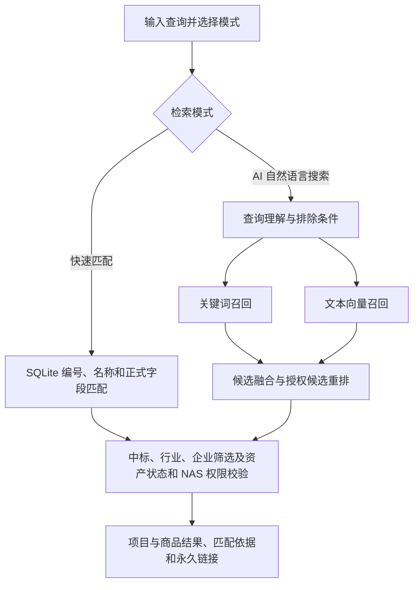

# NAS 设计资产工作台 · 商品与项目检索方案（V1.1.4 · 双模式检索）

> 日期：2026-11-17。本文取代旧版“TXT 拆卡 + 固定词表 + 外部大模型单路排序”的检索设计。业务权限与商品状态以 [02-入库流程](02-入库流程.md) 为准，检索实现以 [03-技术架构](03-技术架构.md) 为准，数据及向量模型以 [05-数据存储与向量关系](05-数据存储与向量关系.md) 为准。
>
> V1.1.4 增加显式检索模式。变更、验收范围与现场验证见 [PROGRESS.md](PROGRESS.md)。

---

## 0. 现状、目标和边界

历史原型采用“图片 → 多模态识图 → TXT 记录 → 关键词粗筛 → 模型排序”的方式，存在 TXT 包含多个商品难以归属、词表约束、搜索时扫描 NAS 和项目身份不稳定等问题。旧版的部分原则（NAS 保存原件、SQLite 作为检索卡片柜、人工考卷验证）继续保留，但具体检索机制以下述新版为准。

**支持**：通过项目编号、名称或企业定位项目；对正式单品和套装使用快速关键词匹配或 AI 自然语言检索；打开授权项目和商品并预览或下载文件。

**V1 不支持**：PDF/合同/标书/发票等资料文件正文检索或向量化；直接以图片作为查询图的图搜图；原始视觉向量召回；模型把套装照片自动拆成若干单品；同型号多图自动归并。搜索结果通过项目链接浏览资料夹，不能声称“商品与某个设计源文件存在精确匹配”。

## 1. 搜索单位、资产身份与可见性

- **商品单位**：`单品/` 或 `套装/` 下**一张代表性主图 = 一个商品 ID**；一个套装可以有零个或多个单品关系，一个单品可属于多个套装。
- **永久身份**：项目、商品、文件使用不可变 ID；商品替换主图沿用商品编号，旧图保留独立文件链接和历史版本；固定 URL 来自 `public_base_url` 内网域名。
- **数据权威源**：正式业务数据以 SQLite 为准；NAS 存储原始文件及项目/商品/历史档案，用于灾难恢复。搜索不通过逐个 NAS 文件夹实时遍历构建结果。
- **结果可见性**：仅返回已正式入库且有效的项目/商品，不返回「入库中」「入库异常」「已作废」「已删除」对象。对已作废对象的**直接永久链接**仍显示作废信息，并允许有 NAS 读取权限的用户访问尚存历史文件。
- **访问授权**：工作台会话和 NAS 读取权限均校验；搜索、预览、下载记业务级日志，不记录密码、Cookie 和密钥。

## 2. 标签与可检索文本

固定 11 个字段：`category` 品类、`material` 材质、`color` 主色、`style` 风格、`festival` 节日场景、`audience` 受众群体、`usage_scene` 使用场景、`size` 尺寸、`craft` 工艺、`material_name` 物料名称、`structure` 结构。

1. 字段是**自由文本**，可填写多值，没有固定下拉枚举词表；管理员只能修改字段 `hint` 和排序，不能新增、删除、停用、更名。
2. 每张新增/替换的主图必须至少一次成功通过 AI 视觉识别；用户随后**逐项确认 11 字段**，可以确认无法确定并保留空值。未核对与确认空值在数据结构中分开记录。
3. 用于检索的正式语义文本是：商品名称 + 已确认且非空的 11 字段值 + 自由描述。跳过空值及“无法确定”状态，不能将其当作真实商品属性。
4. `terms` 可按 `、，,；;/` 拆分自由文本用于关键词匹配；拆词不是限制输入词表，不得在搜索时把任意字段未命中解释成“数据错误”。
5. 调整 `hint` 只影响未来识图与查询解释、版本化缓存失效，不批量重新打标或重建历史向量。商品名称/标签/自由描述更新若改变语义文本，则在影子版本阶段准备新向量，成功后同步发布。

## 3. 双模式检索

### 3.1 快速匹配

页面与全局搜索框默认使用快速匹配。SQLite 按明确的空白和标点拆分关键词，保留编号内的连字符，最多保留前 12 个不同关键词。中文词保持整体，英文字母与编号支持常规大小写匹配。命中的项目最多返回 5 个，商品默认返回前 10 个。

- 项目匹配字段包括编号、名称、企业标准名和别名、行业及中标状态。
- 商品匹配字段包括编号、展示名、类型、正式确认的固定 11 项标签及其 `terms`、正式自由描述。未确认标签和无法判断的空值不参与排序。
- 编号精确命中直接返回，并遵循全部筛选和权限规则。其他结果优先覆盖更多关键词，随后依次比较名称全匹配、名称前缀、名称包含、品类／材质／物料名称、其他标签和自由描述。相同排序条件按 ID 返回。部分命中的结果明确显示覆盖数量。
- 匹配和排序在 SQLite 中完成，仅为入围结果分批读取卡片字段并执行 NAS 权限检查。记录使用的索引包括不区分 ASCII 大小写的编号索引、项目筛选索引和确认标签索引。普通包含查询仍需检查筛选范围内的文本。
- 快速匹配不使用模型、查询缓存或向量索引。结果的命中理由来自真实本地字段。对某个匹配项目的已登记目录或商品主图，使用登录人的 NAS 会话核验可读性。

### 3.2 AI 自然语言搜索

用户主动切换模式并提交。WP11 继续使用查询理解、字段关键词与同义表达、排除词、查询缓存、文本 Embedding、正式向量索引、候选融合和 AI 重排。重排只接收已获授权的脱敏候选。完整编号仍可本地直达，省去模型调用。

查询理解、向量召回或重排失败时保留可核实的本地候选，并提示「AI 搜索部分能力不可用」。返回模式仍为 `semantic`。仅在实际取得向量或重排结果时返回对应分数或理由。

### 3.3 请求与响应

`POST /api/search` 接收 `query`、`mode`、`won`、`industry`、`company` 和可选 `limit`。客户端显式传 `quick` 或 `semantic`，历史客户端省略 `mode` 时继续执行 `semantic`。两种模式共用正式资产、过滤范围及结果卡片。切换保留输入和筛选，下一次明确提交才搜索。

响应的 `mode` 表示实际执行模式。快速匹配的 `usage` 为 `[]`，`vector_candidates` 为 `0`，`index_generation` 与商品 `similarity` 为 `null`。仍返回 `search_id` 供点击审计。管理后台和 CSV 中可以看到本次检索模式。历史日志标记为旧入口 `semantic`，以原 AI 调用记录判断实际是否使用模型。

## 4. 正式入库与向量可用性

- WP09 第 1～8 步完成 NAS 原件、档案及 SQLite 登记，状态仍为 `ingesting`，普通搜索与项目页面不可见。
- 第 9 步为必要向量生成/验证门禁：所有当次商品向量成功才标记 `active` /「已入库」。
- 如果部分向量失败，已上传原件、元数据和成功向量保留；自动限次重试后进入「入库异常」，原终审按规定恢复未成功部分，不能显示为正常入库。
- 入库后补充、替换、改标签/描述等先生成影子商品版本、必要向量与档案；成功后统一发布，不得让旧版搜索与新版元数据错配。
- 如果更换 Embedding 模型，建立蓝绿并行索引。新模型全量覆盖所有有效商品，校验模型 ID、版本、维度、文本哈希后原子切换，保留旧索引回滚；构建期间新变更同时维护新旧向量。**候选新模型失败不影响旧正式索引上的业务流程，但禁止索引切换。**

## 5. 套装关联与历史版本

- 商品关系从 `product_relations` 与档案读取。空关联套装合法，但需上传人显式「无关联单品」确认；不能自动生成不存在的单品。
- 替换任何单品/套装主图时原关系作为待确认数据，所有受影响关系必须人工复核；原关系直到新批次全部满足审核与门禁后仍有效。
- 单品作废后，与套装关系暂时失效但保留历史；恢复时仅自动激活仍然有效且未被后续正式修改的关系。套装作废仅影响套装本身，单品保留原状态。
- 已作废商品不出现在正常搜索；通过原商品/文件链接显示作废提示并允许有 NAS 读取权的用户预览下载仍存在的历史文件。已物理删除则链接显示删除记录，不保证文件可取。

## 6. 数据安全与日志

浏览器只访问公司内网固定域名的工作台 `HTTP:8080`；后端用登录人的 NAS 会话读取文件。内部 HTTP 上的 NAS 密码和会话 Cookie 存在明文传输风险，必须限制授权客户端网段、阻断公网并披露风险；DSM 与百炼使用 HTTPS。外部模型只接收去 EXIF 的缩小主图和必要标签/描述/候选文本，不接收 NAS 路径、NAS 账号、企业名称、项目编号或项目资料原件。

`search_logs` 记录逻辑查询，`access_logs` 或等价审计结构记录预览与下载；避免把一个 Range 请求拆为重复业务事件。不得存储密码、原始 Cookie、完整外发业务图片或敏感配置。

## 7. 测试考卷与验收

延续旧方案的**100～200 条真实查询考卷**：包含编号、属性、场景、同义表达和无结果查询，业务人员标注应该命中的商品/项目。验收从下面维度出具可复现结果：

| 维度 | 需要检查 |
|---|---|
| 召回 | 快速匹配的明确命中与词覆盖，AI 模式的关键词与向量召回贡献 |
| 排序 | 标准答案在 Top 3 / Top 10 的比例、无结果不伪造 |
| 可见性 | 仅有效已入库商品出现在搜索；补充过程中旧版仍可用 |
| 一致性 | 影子版本发布、历史链接、套装关系、模型切换前后与 DB/档案一致 |
| 失败恢复 | 向量失败不会标「已入库」；正式索引旧版可用；重试幂等 |
| 效率成本 | 分模式比较平均和 P95 响应时延、模型调用量及降级次数，快速匹配的模型调用量须为零 |

搜索上线后保留查询与用户点击的审计记录，为扩展考卷提供数据，但不据此自动修改人工已确认的标签。

## 8. 本版实现边界

对应 WP11 的检索引擎与搜索页面，以及 WP09、WP12 的向量门禁和版本发布。是否引入文档 OCR、文搜图/图搜图、专业向量数据库、PostgreSQL 或跨部门二次授权均属未来独立方案，**不在现有 V1 中实施**。

> 代码当前完成情况与现场验证见 [PROGRESS.md](PROGRESS.md)；历史冲突与技术适配事项见 [QUESTIONS.md](QUESTIONS.md)。本设计文档的更新不等于相关代码已经完成。
