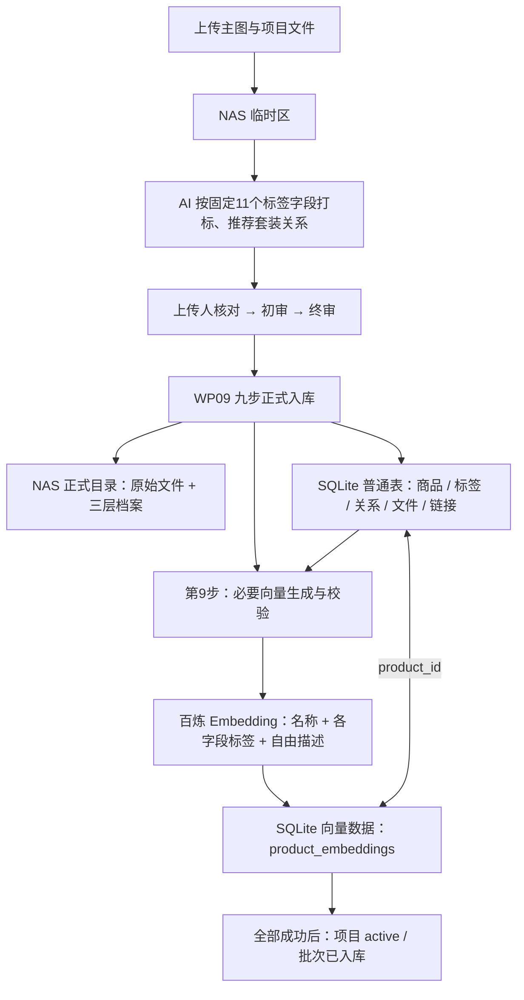

# NAS 设计资产工作台 · 数据存储、AI 标签与向量检索关系增补（v2.0 · 50项规则统一修订版）

> **文档性质**：对《技术架构设计 v2.0》的数据模型、两阶段变更及向量检索机制的补充，与其他三份修订版同时生效。
>
> **对应开发依据**：《NAS 设计资产工作台 · Codex 分阶段提示词（v2.0）》中的 WP06、WP07、WP09、WP11、WP12、WP13、WP14，以及技术架构设计 v1.1。
>
> **业务规则优先级**：AI 标签**字段和填写说明**以 `docs/02-入库流程.md` 第 9.5 节为准；目录和档案格式以该文档的相应条款为准；实现步骤依照对应工作包。本文**不新增标签字段、不设固定标签选项、不编造标签取值或商品档案内容**。
>
> **建议引用位置**：技术架构设计第 2 节「系统分层」之后；第 6、8、9、10、13、14 节引用本增补即可。

---

## 1. 数据架构的确定结论

系统使用 **NAS 原始文件与档案 + SQLite 普通业务表 + SQLite 商品向量数据**。这里的“普通业务表”和“向量数据”均存放在 Windows 工作台的同一个 SQLite 数据库文件 `data/app.db` 中；**不需要第三套独立数据库**。

| 数据部分 | 存储位置 | 负责保存 | 对应功能 |
|---|---|---|---|
| NAS 原始文件与档案 | 群晖 NAS `/设计资产/` | 项目原始文件、单品档案、套装档案、`_项目档案.txt`、历史版本 | 资产长期保管、文件读取与下载、档案校验、灾难重建 |
| SQLite 普通业务表 | Windows `data/app.db` | 项目、文件、商品、确认后的标签、套装与单品关系、永久链接、批次、审核、任务、日志等 | 系统业务操作、结构化查询、状态管理与关联定位 |
| SQLite 向量数据 | **同一个** `data/app.db` | 商品文本生成的向量、商品 ID、文本哈希 | 自然语言语义召回 |
| 本地缩略图缓存 | Windows `data/thumbs/` | 三档缩略图和预览图 | 加快列表和预览加载；不是商品档案，也不是向量 |

- 向量查询优先采用 `sqlite-vec`；在 Windows 上无法加载该扩展时，按照 WP11 使用 **BLOB 保存向量 + NumPy 计算余弦相似度** 的既定后备实现。
- SQLite 和 NAS 保存的部分商品元数据会重复，这是业务查询与长期存档的不同用途所需；向量是由确认后的商品文本生成的**派生数据**，不是第三份可读的商品档案。
- 原始图片、设计稿等文件保存在 NAS，不写入 SQLite 商品表或向量表。

## 2. 三者通过什么信息关联

| 对象 / 既有表 | 关联字段或内容 | 作用 |
|---|---|---|
| `projects` | 项目主键、立项编号、当前位置 | 定位项目及其 NAS 目录 |
| `files` | `project_id`、项目内 `rel_path`、文件指纹 | 将商品主图及其他资料文件定位到 NAS |
| `products` | 商品主键 `id`、`product_code`、`project_id`、`file_id`、`archive_rel_path`、`free_text` | 将商品与所属项目、主图、档案和自由描述关联 |
| `product_tags` | `product_id`、`field_key`、`value`、`terms`、`source`、`ai_value`、`flag` | 保存各已确认标签及检索用词项 |
| `product_relations` | `set_product_id`、`item_product_id` | 保存套装与单品的多对多关系 |
| `product_embeddings` | `product_id`、`embedding`、`text_hash` | 将语义向量与同一商品对应起来 |
| `links` | `kind`、`target_id`、`link_id` | 对项目、文件、商品生成稳定链接 |

**关联原则：** 系统内部通过 `product_id` 对应商品、标签和向量；NAS 档案使用既定商品编号及档案结构记录商品信息。文件路径用于定位，不代替商品身份标识。商品编号的实际发放规则执行 WP09：**“立项编号-三位流水”，先单品后套装**；不沿用其他版本中的假设性编号样例。

## 3. AI 标签范围：严格执行已确认的 11 个字段

### 3.1 已确认的初始字段清单

下表是 WP06 明确要求的数据迁移初始字段。**字段的具体填写说明（`hint`）逐项取自《入库流程》第 9.5 节，不在本增补中重新撰写或改写。**

| 顺序 | 标签名称 `label` | 字段标识 `key` |
|---:|---|---|
| 1 | 品类 | `category` |
| 2 | 材质 | `material` |
| 3 | 主色 | `color` |
| 4 | 风格 | `style` |
| 5 | 节日场景 | `festival` |
| 6 | 受众群体 | `audience` |
| 7 | 使用场景 | `usage_scene` |
| 8 | 尺寸 | `size` |
| 9 | 工艺 | `craft` |
| 10 | 物料名称 | `material_name` |
| 11 | 结构 | `structure` |

### 3.2 字段填写与存储规则（WP06、WP07）

1. **全部为自由文本**：没有固定选项和标准值列表；同一字段允许多个值，值之间使用顿号；不限制标签值的数量。
2. **必须逐项确认但可留空**：11 个字段每项必须由人确认，确认具体值或「无法确定」；无法确认的最终标签保存 NULL／空值和 `confirmed_unknown` 状态，绝不能把「无法确定」当作可检索特征。
3. **严格区分两个场景字段**：`festival` 只记录具体节日；`usage_scene` 记录用途和场合。其余字段解释均以第 9.5 节原文为准。
4. **打标提示词动态读取字段**：只向模型列出固定 11 个字段及其当前 `hint`，每个字段生成中文自由文本，模型无法判断时返回空值及不确定状态，不编造。
5. **保留自由描述**：除 11 个标签字段外，模型输出 `free_text`；人工在核对页可修改该描述。
6. **保留原始 AI 值与来源**：`product_tags` 保存 `value`、`source`、`ai_value`、`flag`；来源值为 `ai`、`manual`、`ai_confirmed`。
7. **词项 `terms` 的生成**：从 `value` 按 `、`、`，`、`,`、`；`、`;`、`/` 拆分，去空白、去重后形成数组，供字段检索和输入提示使用。**词项拆分不等于标签标准化，也不得反向限制用户填写。**
8. **标黄仅限已定义的三种情况**：字段无法判断 `uncertain`、单品图识别多个商品 `multi_object`、套装推荐清单为空 `empty_relation`；不新增取值校验或套装与单品标签矛盾校验。
9. **人工编辑约束**：单字段文本修改去除首尾空白、最大 500 字，同时重新拆分 `terms`；修改后 `source=manual`，保留 `ai_value`；确认 AI 原值正确则 `source=ai_confirmed`。
10. **字段管理**：管理员仅可修改 11 个固定字段的 `hint` 与显示顺序，不能增删、停用、改名；提示修改仅影响后续 AI 识别和查询理解缓存，不影响历史标签和历史向量。

**不得在数据架构中增加未确认的“情感属性”“文化寓意”“身份象征”等标签字段，也不得给 11 个字段自行编写一套固定可选词表。**

## 4. 从图片到档案、普通表和向量的既定流程

### 4.1 上传、识图与人工确认（WP04～WP08）

1. 文件分片上传到 NAS `/工作台临时区/`；SQLite 的 `batches`、`batch_files` 记录批次、上传进度、文件状态和指纹。
2. 主图上传完成后生成 300px 缩略图、1600px 预览图和长边 1024px 的送审图；送审图去除 EXIF。
3. WP06 先创建单品及套装对应的 `batch_products`；**先处理全部单品，再处理套装**。单品打标使用固定11个字段及填写说明；套装一次模型调用同时进行打标与包含单品关系推荐。
4. AI 的结果写入 `batch_products.tags`、`free_text`、`relation_items` 等批次数据；位置推荐依据企业→行业对照表，不由识图模型决定。
5. 上传人逐项确认 11 个标签（允许确认空值），处理标黄项并确认套装关系（允许明确「无关联单品」）；每张新增或替换主图必须先有一次成功 AI 视觉识别。提交后冻结全部待审快照，再由两名与提交人不同的审核人员完成初审、终审。
6. 送往百炼的识图内容按照现有开发约定：送审图及字段说明；**不发送 NAS 路径、账号、立项编号、企业名和资料夹内其他文件**。

### 4.2 终审通过后的九步入库（WP09）

1. 编号和目标目录检查，持有编号级首次入库互斥锁。
2. 终审 NAS 账号按对照表建中标状态／行业／企业目录。
3. 移动批次项目到正式目录，以终审身份自动补齐缺失的五个空资料夹。
4. 先单品后套装发商品编号，**持久写入** `batch_products.product_code`，重复执行不重新发号。
5. 写入 `单品档案/{product_code}.json`／`套装档案/{product_code}.json`，含不可变身份与永久 link_id、标签、关系、主图文件版本。
6. 建 `_历史版本/`、`_项目档案.txt`，记录可从 NAS 档案重建原项目／商品／文件／历史永久链接的完整映射。
7. 一个 SQLite 事务写入项目、文件、商品、已确认标签、关系和链接，**项目仍为 `ingesting`，不向普通用户开放**。
8. 校验链接、档案、SQLite 映射一致性，永久 URL 采用固定内网 `public_base_url`。
9. 生成／核验所有商品正式 Embedding，**全部完成之后**原子标记项目 `active`、批次「已入库」。部分失败保留已成功成果，限次重试后状态「入库异常」，终审可重试缺失向量。

第 5～6 步 NAS 档案依确认批次数据生成，第 7 步成为后续修改的权威业务数据。JSON 档案中的结束标记是合法 JSON 属性（`"结束标记":"完"`），文本项目档案使用结束行，不能向 `.json` 追加非 JSON 尾行。

### 4.3 向量生成与模型迁移（WP11）

- 商品唯一正式语义文本为：**名称 + 11 字段中已经人工确认且非空的标签值 + 自由描述**；未确认、确认无法确定的字段均跳过，不把「无法确定」拼入检索语料。原始图像本身不直接产生本版商品检索向量。
- 每条向量至少保存 `product_id`、文本哈希 `text_hash`、模型 ID／版本／维度、索引代次、状态和向量值。文本哈希和正式模型一致时可复用。
- 首次入库第 9 步是正式向量门禁；必要向量失败时不得提前「已入库」。正常补充／变更使用影子商品版本与影子向量，成功后原子激活；失败不影响旧版本。
- 模型切换按蓝绿双索引处理：旧索引为服务真源，新索引全量重建并检查所有有效商品覆盖率、尺寸、文本哈希后原子切换，保留回滚索引。
- 双索引构建期间新增和修改商品同时生成旧正式模型与新候选模型向量；新模型失败**不阻止旧正式模型业务完成**，但阻止模型切换。对于新候选模型的失败保留待补齐任务。
- 可选向量实现：Windows 可用时首选 sqlite-vec，失败采用 SQLite BLOB + NumPy；这两种都是同一 `app.db` 的不同计算实现，不另启数据库。

### 4.4 数据关系流程图

> 两套存储的操作由应用服务和入库步骤协作完成；NAS 文件操作和 SQLite 事务不构成一个跨系统原子事务。中断恢复依靠 WP09 的九步幂等机制。

## 5. 搜索阶段怎样协同（WP11）

| 步骤 | 处理方式 | 所使用的数据 |
|---|---|---|
| 1. 编号直达 | 识别立项编号或商品编号，精确查找、置顶；此路径不调用模型 | SQLite 普通表 |
| 2. 查询理解 | 大模型读取用户原话、当前启用字段名称及 `hint`，输出分字段关键词、每词 2～5 个同义说法、排除词和其他关键词；按“查询文本 + 字段版本”缓存 | 百炼文本模型、SQLite `query_cache` |
| 3A. 字段关键词召回 | 对照相应字段的 `terms` 和 `value` 匹配关键词及同义说法；按命中字段数计分，并参考自由描述和物料名称；不足时按 WP11 放宽字段范围 | SQLite `product_tags`、`products` |
| 3B. 向量召回 | 将用户原始查询文本转换成向量，召回语义最相近的 **Top-50** 商品 | SQLite `product_embeddings` |
| 4. 合并 | 两路候选去重，最多 **60** 条，只保留有效商品 | SQLite 普通表与向量存储 |
| 5. 大模型排序 | 仅发送候选临时序号、商品名称、标签和自由描述，要求返回 **Top-10** 及理由；失败则按“关键词命中优先，其次向量相似度”降级排序 | 百炼文本模型 |
| 6. 结果展示 | 组装商品信息、缩略图、套装关系、所属项目及永久链接；项目名、编号、企业名的模糊命中另列项目区块（最多 5 个） | SQLite 关联查询 + NAS 文件读取 |

**职责界限：** 标签和自由描述提供明确的可读事实；向量负责语义相似度候选召回；大模型负责需求理解及候选排序。当前方案实现的是**商品文本语义向量检索**，不等同于“原始图片直接做视觉向量检索”。

## 6. 修改、巡检与一致性规则（WP12～WP13）

| 已有业务动作 | SQLite 普通表 | NAS 档案及文件 | 向量处理 |
|---|---|---|---|
| 首次入库 | 先写 `ingesting`，必要向量全部完成后才 `active` | 生成三层档案并保存稳定身份和原链接映射 | 第 9 步必须同步完成正式模型向量门禁 |
| 修改标签、商品名或描述 | 待审新版本与向量预备完成后统一生效，失败不修改旧正式版本 | 新档案暂存，最终切换时发布 | 正式模型向量须成功；`text_hash` 未变则跳过 |
| 修改套装关系 | 保存历史关系版本，双审通过后统一生效 | 同步更新有关单品／套装与项目档案 | 文本哈希未变不生成新向量 |
| 改名、移动 | 更新项目/文件定位信息 | 按已审核操作修改 NAS 文件或目录，重建档案 | 按 WP12 派发任务；输入文本未变则跳过 |
| 作废、恢复、删除 | 更新商品与文件状态、历史版本、操作日志 | 执行既定作废、历史版本和删除规则 | 搜索只保留有效商品；受影响商品按既有任务执行规则处理 |
| 巡检发现档案不一致 | 写入 `inspection_findings` | 系统巡检账号**只读**；终审通过修复功能执行 `archive.rebuild` | 不把档案差异直接当作新标签重新识别 |

**跨系统失败的既定处理：**

- 入库执行记录 `batches.ingest_step`；必要向量失败或终审 NAS 会话失效时，批次变为“入库异常”，记录错误，并由终审重新登录后通过 `resume-ingest` 继续。
- 入库和入库后操作使用已有 `jobs` 队列与幂等重试机制，不以“某一步成功”代替“整个批次完成”。
- `archive.verify(project)` 对 NAS 档案和卡片柜做一致性校验；发现异常形成巡检结果，由终审按权限修复。
- **不使用 `wb-system` 写入正式目录**；系统账号仅用于正式目录的只读巡检与备份目录写入。
- 本文不新增未经工作包定义的业务状态、数据表或同步服务；需要扩展实现时遵循项目 `AGENTS.md`：把文档冲突写入 `docs/QUESTIONS.md`，不得自行发明业务规则。

## 7. 备份与恢复边界（WP13、WP14）

1. **每天 02:00 巡检**：只读遍历正式目录，校验项目与文件记录、指纹变化及三层档案；报告异常，权限允许的终审进行修复。
2. **每天 03:00 备份**：通过 `VACUUM INTO` 制作 SQLite 一致性快照，连同 `config.yaml`、`secret.key` 打包，备份到 NAS `/_工作台备份/`；本地暂存仅保留最近 7 份，NAS 端按现有规则永久保留。
3. **有 SQLite 备份时**：从备份包恢复 `app.db` 等文件；普通业务表与向量数据作为同库内容一同恢复。
4. **数据库及备份均丢失时**：WP14 的 `rebuild_catalog.py` 通过系统账号只读解析项目、单品、套装档案，重建 `projects`、`files`、`products`、`product_tags`、`product_relations`、`history_versions`、`links`；随后重建缩略图与商品向量。
5. **不能仅凭 NAS 商品档案恢复**完整的审核记录、操作日志及用户角色；WP14 要求在重建报告中列出这类无法恢复的数据。

## 8. 交付给 Codex 的实现约束与验收点

- **WP06**：固定不可增删的 11 个标签字段的 `label/key/hint` 按 `docs/02-入库流程.md` 第 9.5 节写入迁移；自由文本、无限选项、11 字段逐项人工确认但具体值可为空；单品先打标、套装后打标并推荐关系；严格执行 `terms` 拆分和三种标黄规则。
- **WP07**：核对页按已确认字段和说明展示；允许修改标签、描述、套装关系；编辑保留 `ai_value` 和 `source`；提交不要求所有标签非空。
- **WP09**：执行确定的九步入库，写三层档案和 SQLite 卡片柜，校验档案一致性，第 9 步完成必要 `embed` 后才标「已入库」；失败按 `ingest_step` 继续。
- **WP11**：使用**“名称 + 各字段标签 + 自由描述”**生成向量；`text_hash` 未变化跳过；两种 `VectorStore` 实现统一接口；执行已明确的同义扩展、关键词/向量双路召回、大模型排序及降级策略。
- **WP12**：入库后修改强制两级审核；影子版本及必要向量成功后正式切换；关系历史版本和作废恢复按第 13 节实施。
- **WP13**：只读巡检、终审修复、SQLite 定时备份和一致性报告。
- **WP14**：从 NAS 三层档案重建指定数据表，并明确无法重建的审核、日志、角色信息。

---

## 9. 与原文的对应章节

| 原文件 | 相关章节 / 工作包 | 本文明确的关系 |
|---|---|---|
| 技术架构设计 v1.1 | 第 2、6 节 | NAS 与 SQLite 的物理位置；普通表和向量表同库及 ID 关联 |
| 技术架构设计 v1.1 | 第 8、9、10 节 | 入库、`embed`、关键词和向量检索的先后关系 |
| 技术架构设计 v1.1 | 第 13、14 节 | 档案校验、备份与灾难恢复 |
| Codex 分阶段提示词 v1.1 | WP06、WP07 | **已确认的 11 个标签及自由文本处理规则** |
| Codex 分阶段提示词 v1.1 | WP09、WP11 | 三层档案、商品编号、向量文本拼接、双路召回 |
| Codex 分阶段提示词 v1.1 | WP12、WP13、WP14 | 修改同步、巡检修复、备份与重建 |

**执行原则：以已确认的业务规则与 v1.1 工作包为准；不得把概念演示值、个人推测的标签含义、旧版词表或其他项目的字段写进本项目的数据模型。**

---

## 附录 A：50 项确认规则总索引（2026-11-17）

本索引作为四份文档的共同约束。编号即交互确认问题编号；若旧描述与本版的详细章节冲突，以本版详细章节为准。**问题 51 未确认，不属于基线。**

| 编号 | 已确认的强制规则 |
|---|---|
| 01 | 物理删除只限已作废资产，严格 30 天冷静期，必须初审、终审，终审人用本人 NAS 身份执行。 |
| 02 | 8 小时工作台会话可失效；既有 SMB 上传连接正常时允许传完，断线后保存进度、重新登录恢复；不长期保存普通用户密码；同一用户不同设备独立会话。 |
| 03 | 首次入库九阶段：第 4 步把商品编号持久化到批次，第 5～6 步按确认的批次数据生成档案，第 7 步写正式 SQLite；后续正式业务以 SQLite 为准；各阶段幂等。 |
| 04 | 数据库和所有数据库备份损毁时，NAS 档案仍须支撑重建项目、商品、文件及历史版本的原永久链接。 |
| 05 | 终审修正公司时必须联动项目目录名公司段、NAS 路径、SQLite、档案；ID 和链接不变，冲突时阻止覆盖。 |
| 06 | 单品与套装档案的 JSON 文件名只有商品编号，不带商品展示名。 |
| 07 | 全部入库后变更（轻操作、修复、补充、替换、作废、恢复、移动、物理删除等）统一走两级审核。 |
| 08 | 首次入库须至少一张商品主图；仅文档的批次只允许作为已有项目补充。 |
| 09 | V1 只对商品名称、11 个标签和自由描述进行文本语义检索；项目可按编号、名称、企业查找；文档内容不建全文或向量索引。 |
| 10 | 绕过工作台移动 NAS 文件：仅身份可靠时自动纠正物理路径，记录违规和通知管理员；不自动更改企业、行业及中标分类。 |
| 11 | 绕过工作台覆盖内容：保留原指纹，记录违规；可警示性预览和下载当前文件；正式确认仍须两级审核。 |
| 12 | 上传的每个文件不论大小均计算完整 SHA-256；相同内容的不同文件保留不同文件 ID。 |
| 13 | 搜索、预览、下载均记录访问日志，不含口令、令牌等秘密。 |
| 14 | 首次入库的全部商品必要向量成功后才可标记「已入库」。 |
| 15 | 首次向量部分失败：保留已成功的 NAS、SQLite 和向量结果，批次「入库异常」；限次自动重试后由终审恢复缺失项。 |
| 16 | 首次入库中的「入库中／入库异常」项目，普通用户不得通过工作台搜索、项目页、预览、下载看到；具备职责的提交人、审核人、管理员可看进度与错误；不改变 NAS 原生权限。 |
| 17 | 入库后标签、名称、描述等向量输入变更：新版本预备并生成向量成功后才整体切换；失败仍使用旧版；文本哈希不变不重算。 |
| 18 | 补充／替换批次采用新旧版本隔离，必要向量全部成功后统一生效；失败只影响新批次；仅文档的补充跳过向量。 |
| 19 | AI 标签严格固定 11 个字段，管理员只能调整字段提示 `hint` 和显示顺序，不得增删、禁用、改名。 |
| 20 | 修改 `hint` 只作用于新生成的 AI 结果；不追溯重打历史标签，查询理解使用最新提示，缓存按版本失效。 |
| 21 | 更换 Embedding 模型使用双索引：旧模型继续服务、新模型完整重建并核验身份、维度、覆盖率后原子切换，保留回滚。 |
| 22 | 双模型过渡期新／改商品同时生成旧新两份向量；新模型失败不得阻塞旧模型上的正常业务，但禁止切换新模型。 |
| 23 | 套装可以没有任何单品关联；空关系标黄，由上传人显式确认「无关联单品」，与未确认区分。 |
| 24 | 每一张有效的单品主图各对应一个独立商品 ID，角度图、细节图不合并为同一单品主图。 |
| 25 | 工作台内网 HTTP、端口 8080、防火墙限制内网访问；无需 HTTPS；须显著披露 NAS 口令及 Cookie 明文传输的局域网风险；DSM/百炼采用 HTTPS。 |
| 26 | `wb-system` 保留：正式资产只读、临时区无权、备份区读写，02:00 只读巡检、03:00 备份；不写正式资产。 |
| 27 | NAS 档案灾难重建恢复商品、标签、套装关系、历史版本及永久链接；审核、角色和操作日志在 DB 与所有备份同失时可以无法恢复，须如实报告。 |
| 28 | 管理员个人 NAS 身份有整个临时区的读／删权限（含他人批次），需显式操作确认和留痕；不因此拥有正式资产写权限。 |
| 29 | 临时区只清理已结束批次及证实不属于活动批次的孤儿文件；不能清理活动中或异常待恢复批次，无强制终止。 |
| 30 | 整项目恢复优先回原位置；冲突或目录变更时终审在两级审核流程内选择新位置；不得覆盖，ID 和链接不变。 |
| 31 | 单品作废时关联暂时失效、历史保留；恢复时仅对仍有效且未被后续正式修改的关系自动激活。 |
| 32 | 无公司编号的历史项目由上传人选择真实所属年份，按该年份发放唯一 `HYYYY-流水号`。 |
| 33 | 已作废资产退出正常搜索，但原永久链接仍显示作废状态，具 NAS 读取权限者可查看／下载仍存在的历史文件。 |
| 34 | 物理删除严格等待自最近一次有效作废日起满 30 天，不设例外；满期仍须两级审核。 |
| 35 | 五个规定资料夹缺失仅提醒；正式入库时由终审 NAS 身份自动补齐空资料夹，已有内部结构不变。 |
| 36 | 同一立项编号同一时刻至多一个进行中的首次入库批次；完成后转补充，终止后可重新首次入库。 |
| 37 | 同一已入库项目同一时刻至多一个未完成的入库后操作批次；异常待恢复仍占锁。 |
| 38 | 初终审人员必须在同一审核轮次不同，跨轮次可交换角色；每轮独立留痕。 |
| 39 | 作废套装只影响套装，绝不级联作废单品；单品作废独立发起两级审核。 |
| 40 | 永久链接统一使用固定内网域名 `public_base_url`，服务器迁移时改内网 DNS；继续 HTTP/8080。 |
| 41 | 补充替换主图允许人工指定既有 `existing_product_id`；文件名可变，商品编号与商品链接不变，旧主图入历史版本。 |
| 42 | 主图替换时旧套装关系预填为待复核，受影响关系逐项确认后才能提交；正式生效前旧关系不变。 |
| 43 | 主图替换后原有 11 标签与新 AI 值逐字段对照，上传人选择沿用、新值或人工改写；逐字段确认后才能提交。 |
| 44 | 11 字段均须人工确认，但允许明确「无法确定」且空值；区分未确认与已确认空值；不得将「无法确定」作为检索特征。 |
| 45 | 每张新增／替换主图必须至少一次 AI 视觉识别成功，无法纯人工绕过；仅文档补充不需视觉识别。 |
| 46 | 发起／提交人不得在自己批次的任何轮次初审或终审；每轮提交人、初审人、终审人三个账号不同。 |
| 47 | 审核人只能通过或驳回、留意见，不得修改待审文件、标签、关系等内容。 |
| 48 | 提交审核后冻结所有待审数据和文件指纹；只有审核驳回后提交人才可修改并重新两级审核。 |
| 49 | 发起人可在终审通过前填写原因并主动**终止**整个批次；终止不可逆、保留历史、释放项目锁；不得借终止修改待审版本。 |
| 50 | 终止后 NAS 临时文件不自动删；管理员用本人 NAS 身份按终态批次人工清理，保留 SQLite 批次与审核日志。 |
